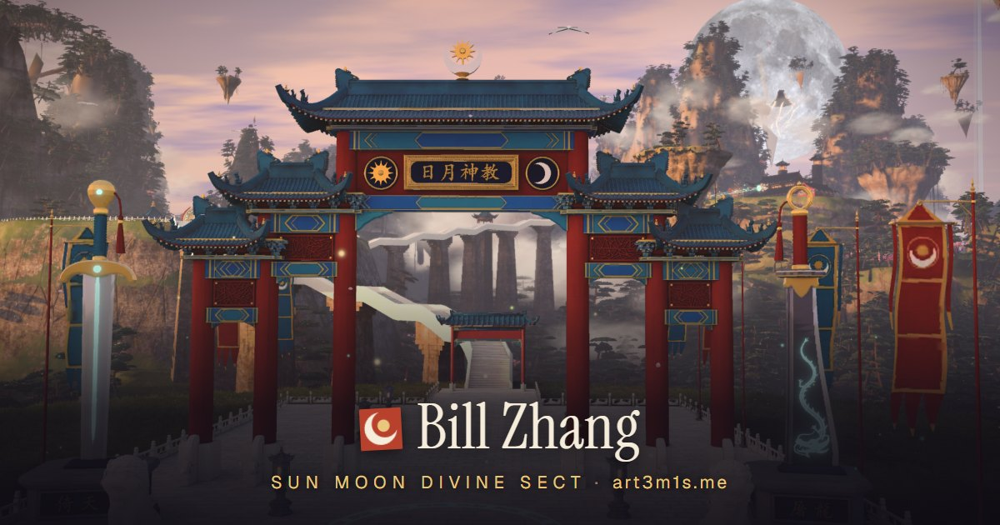
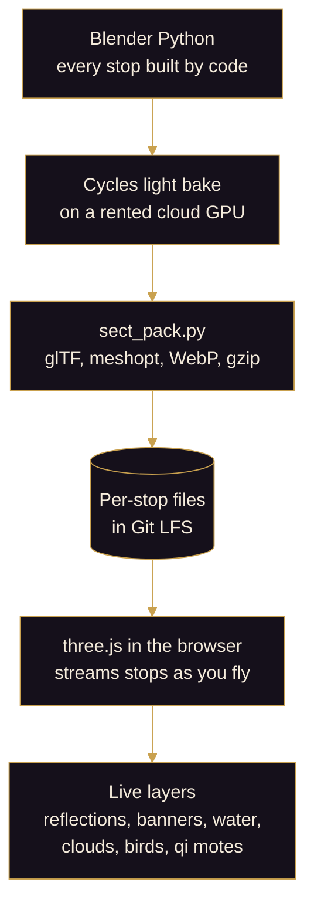
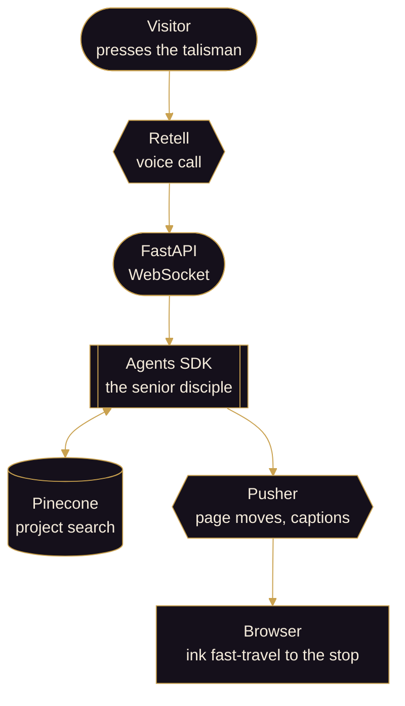

<!--
  art3m1s.me · 日月神教 · the Sun Moon Divine Sect
  Bill Zhang's portfolio: a three.js fly-through of a floating xianxia sect, guided by a senior disciple.
  Author: Bill Zhang (@IdkwhatImD0ing)
-->

<a id="top"></a>

<p align="center">
  <a href="https://art3m1s.me"></a>
</p>

<h1 align="center">日月神教<br/><sub>The Sun Moon Divine Sect</sub></h1>

<p align="center">
  Bill Zhang's portfolio at <a href="https://art3m1s.me"><b>art3m1s.me</b></a>: a floating mountain sect you fly through, with a senior disciple to show you around.
</p>

<p align="center">
  <a href="https://art3m1s.me"></a>
  <a href="https://github.com/IdkwhatImD0ing/PortfolioV5/actions/workflows/test.yml"></a>
  <a href="docs/README.md"></a>
</p>

<p align="center">
  <a href="https://art3m1s.me"></a>
</p>

<p align="center">
  <b>山门已开，拾级而上。</b><br/>
  <i>The mountain gate is open. Climb.</i>
</p>

<p align="center">
  
</p>

## 山门 · The gate: what this is

山门 (shānmén) is a sect's mountain gate, where every visitor arrives.

This repo is my portfolio, live at **[art3m1s.me](https://art3m1s.me)**. There are two ways in.

**Fly through it.** The home page is a flight through 日月神教, a sect of cultivators on peaks that float above the clouds. Scroll, and the camera climbs from the gate to the summit. Each of the eleven stops holds one section of the portfolio. Drag to look around. Press <kbd>M</kbd> for the ink-wash map and pick a seal to fast-travel there. **Read as page** shows everything as one plain page, without the 3D.

**Talk to it.** Press the talisman at the bottom right, or click the moon at the summit. The talisman is a 传音符 (chuányīn fú), a "sound-transmission talisman" that cultivators use to speak across a distance. A senior disciple of the sect answers, by voice or by text. Ask about my work: the disciple searches my projects, answers, and takes you to the right hall by ink fast-travel. Ink washes over the screen while the camera moves, and clears once the place is fully drawn.

The sect is from Jin Yong's novel *The Smiling, Proud Wanderer*. 日 is sun, 月 is moon, 神 is divine, and art3m1s is Artemis, goddess of the moon, so the moon leads and sun-and-moon marks run through the sect. I'm a big Jin Yong fan, and 19 treasures from his novels hide along the way.

The site went live on October 24, 2026. The previous site still runs at [v4.art3m1s.me](https://v4.art3m1s.me).

## 十一处 · The eleven stops

The camera flies one path up a floating mountain range and stops at each place below, in this order.

| # | Stop | Portfolio section | What you'll find |
|:-:|---|---|---|
| 1 | 山门 Mountain Gate | Welcome | A five-bay gate with the 日月神教 plaque, guarded by the Heaven Sword and the Dragon Saber |
| 2 | 心镜台 Heart-Mirror Terrace | About | A giant bronze mirror above a still pond. On Medium and High quality, both show live reflections |
| 3 | 炼器峰 Artifact Forge Peak | Projects | A cauldron circled by 11 prize-winning projects, each forged into a magic artifact |
| 4 | 论剑台 Sword-Discussion Arena | Hackathons | A floating duelling ring lined with banners, with a black iron sword driven through it |
| 5 | 任务殿 Mission Hall | Experience | A wall of seven white-jade boards, one for each role |
| 6 | 藏经阁 Scripture Pavilion | Education | A seven-storey pagoda with one glowing floor per school and scrolls circling it |
| 7 | 碑林 Stele Forest | Skills | Rows of glowing stone tablets, one colour per skill area |
| 8 | 玉简阁 Jade Slip Pavilion | Resume | The resume, kept the way a sect keeps its records |
| 9 | 护宗大阵 Grand Sect-Protecting Formation | How this site works | Eight carved pillars with holy-fire braziers around a bronze armillary sphere. Each pillar explains one part of how the site works |
| 10 | 洞府 Cave Abode | Off the clock | A cliff home with a waterfall, a koi pool and a tea pavilion |
| 11 | 望月台 Moon-Gazing Terrace | Contact | The summit under a giant moon. Click the moon to speak with a senior disciple |

## 法器 · The stack

法器 (fǎqì) are a cultivator's tools.

| Layer | Tech | Why |
|---|---|---|
| Site | Next.js 15 (App Router), React 19, TypeScript 5, Tailwind v4 | One page that renders the sect, plus the portfolio as text under it for search engines and no-JS browsers |
| 3D | three.js, React Three Fiber, drei, postprocessing, three-mesh-bvh | The fly-through, clicking things in the scene, and the glow |
| Scene build | Blender 5.2 Python, Cycles on a rented cloud GPU, glTF Transform with meshopt, WebP, Git LFS | A sect built by code, with light baked once and streamed in small files |
| Voice and chat | Retell (voice calls), FastAPI, OpenAI Agents SDK, Pusher (page moves and captions) | A streaming agent that can move the page while it talks |
| Search | Pinecone with `text-embedding-3-large` | Finds a project by what it does, not just its name |
| Hosting | Vercel (site), Docker on Cloud Run (backend) | A push to `main` ships the site |
| Watching it | Vercel Analytics and Speed Insights, [FireTrace](https://tracing.art3m1s.me) | Real-visitor performance, and one trace per agent run |
| Tests | Vitest, pytest, GitHub Actions | CI runs both suites on every push to `main` |

## 宗门图 · Map of the repo

宗门图 is a map of the sect's grounds.

| Folder | In the sect | What lives there |
|---|---|---|
| [`client/`](client) | the sect itself | The Next.js site. The fly-through is `src/app/sect/`, its tested logic is `src/lib/sect/`, the talisman is `src/components/voice-orb/`, and the packed scene is `public/sect/full/` |
| [`server/`](server) | the senior disciple | FastAPI: the voice WebSocket, text chat, the agent, its navigation and search tools, the guardrail and the two personas |
| [`pinecone/`](pinecone) | the disciple's memory | A one-shot script: `data.json`, then embeddings, then the Pinecone index |
| [`blender/xianxia-sect/`](blender/xianxia-sect) | the mountains and halls | Blender Python for every stop (`sect/`), the bake and export scripts, and [`spec.md`](blender/xianxia-sect/spec.md), the scene's contract |
| [`blender/xianxia-sect/tools/`](blender/xianxia-sect/tools) | the forge's tools | The packer `sect_pack.py`, the remote Blender runner `rblender.py`, and small data fixes |
| [`docs/`](docs/README.md) | 藏经阁, the Scripture Pavilion | Every doc: the design-decisions log, the scene, the voice agent, deploy, music and research |
| [`browserless/`](browserless) | | Deploy script for a separate headless-browser service |
| [`.github/`](.github) | | CI workflows and the images in this README |
| [`Makefile`](Makefile) | | Install everything, run the server, site and tunnel together, run all tests |

## 入门 · Run it locally

入门 (rùmén) means "entering the gate". It is also how Chinese says "getting started".

### The site

The fly-through only needs the client.

```bash
git lfs install          # the scene files live in Git LFS
git clone https://github.com/IdkwhatImD0ing/PortfolioV5.git
cd PortfolioV5/client
pnpm install
pnpm dev                 # then open http://localhost:3000
```

Add `?tier=low`, `?tier=mid` or `?tier=high` to force a quality tier, or `?view=page` to read the sect as one plain page. If you cloned before installing Git LFS, run `git lfs pull` to fetch the scene files.

### The senior disciple (voice and text agent)

The agent needs the server, a public address so Retell can reach it, and the keys below. Install once, then run each of the last three lines in its own terminal, from the repo root.

```bash
make install-deps                                # uv, pnpm and ngrok, then each app's packages
cd server && uv run uvicorn main:app --reload    # the server, on :8000
ngrok http 8000                                  # a public URL for Retell to reach the server
cd client && pnpm dev                            # the site, on :3000
```

Names only. Never commit the values.

```bash
# server/.env
RETELL_API_KEY=...
OPENAI_API_KEY=...
PINECONE_API_KEY=...
FIRETRACE_API_KEY=...            # optional: records every agent run
PUSHER_SECRET=...                # voice page moves and live captions (server/README.md, "Voice events")

# client/.env.local (see client/.env.local.example)
RETELLAI_API_KEY=...             # server-side only, used by the create-web-call proxy
NEXT_PUBLIC_RETELL_AGENT_ID=...
NEXT_PUBLIC_APP_URL=http://localhost:3000
NEXT_PUBLIC_API_URL=...          # optional: backend URL for warm-up and text chat
```

### The search index

```bash
cd pinecone
python load_data.py      # embeds data.json and uploads it to the Pinecone index
```

It needs `OPENAI_API_KEY` and `PINECONE_API_KEY`, and it writes to the live index, so run it only when the project data changes. See [`docs/voice/pinecone/`](docs/voice/pinecone/README.md).

### The scene

You don't need Blender to run the site: the packed scene is already in `client/public/sect/full/`. To rebuild it, the scripts in `blender/xianxia-sect/sect/` run in Blender 5.2 in background mode (`blender --background --python <script> -- <args>`). The light bake needs a big GPU, so it runs on a rented cloud machine. Start with [`spec.md`](blender/xianxia-sect/spec.md) and [`api_look.md`](blender/xianxia-sect/docs/api_look.md), which shows how to render a preview of any module.

### Tests

```bash
cd client && pnpm lint && pnpm typecheck && pnpm test
cd server && uv run pytest tests/ -m "not integration"   # what CI runs
```

<p align="center">
  
</p>

## 炼器 · How the sect is forged

炼器 (liànqì) means "forging artifacts". Here is how the sect gets from code to your browser.



1. **Built by code.** The whole sect is Python that runs inside Blender: one module per stop, plus shared libraries for buildings, props, trees, rock and water. That is about 70,000 lines, not counting one-off patch scripts. A few free photo textures and two CC BY models, the Divine Condor and the gate's guardian lions, come from outside (see [Credits](#鸣谢--credits)).
2. **Lit once, offline.** Cycles, Blender's path tracer, bakes the lighting into textures on a rented RTX 5090. A development bake takes about an hour and a half. The browser never computes this lighting. It just reads the result.
3. **Packed small.** [`sect_pack.py`](blender/xianxia-sect/tools/sect_pack.py) packs each stop into its own glTF files and checks every file before installing it. There are about 60 files, close to 200 MB in all: a full set, plus a lighter set for phones. A visitor downloads only one set, a few stops at a time.
4. **Drawn live.** three.js shows the baked light and adds live layers on top: real reflections in the Heart-Mirror and its pond, banners that wave, flowing water, drifting clouds, birds, cranes, glowing qi motes and peach petals.
5. **Fits the device.** The loading screen picks Low, Medium or High quality from your device, and you can change it. If frames run slow, it steps down. On a desktop, the stop you're at and two on each side stay at full detail.

Every design choice behind this, with its date and reason, is in the [decisions log](docs/decisions/README.md).

## 传音 · The talisman and the senior disciple

传音 (chuányīn) means "sound transmission", the way cultivators speak across a distance. The voice agent is the original heart of this portfolio. In the sect it speaks as a senior disciple who guides visitors through my work, and it never calls itself an AI.



- **The voice moves the page.** The agent calls tools like `display_project`. The server turns each call into a small navigation message and publishes it on the call's Pusher channel. The browser takes you to that stop by ink fast-travel and opens the reader there.
- **Search by meaning.** Every project is embedded into Pinecone. Ask "what did you build for emergency dispatch?" and it finds **DispatchAI**, even though you never said its name.
- **A guardrail that doesn't slow you down.** A small classifier checks each question while the main model starts answering. If it flags the question, the answer is cancelled and replaced with a polite refusal. Normal questions get their first word with no extra wait.
- **Two personas, one backend.** The sect gets the senior disciple. Anything that asks for nothing gets the classic persona (me, in the first person), so the old site keeps working on the same server.
- **Readable by people and machines.** The server renders the whole portfolio as text under the flight, so search engines, language models and browsers without JavaScript can read it. JSON-LD and [`/llms.txt`](https://art3m1s.me/llms.txt) describe the site too.

## 出山 · Deploy and roll back

出山 (chūshān) means "leaving the mountain", going out into the world.

- **Site.** A push to `main` deploys art3m1s.me on Vercel. The Vercel project needs Git LFS turned on, or visitors get pointer files instead of the scene. To roll back, promote the last good deployment in Vercel, then revert the commit.
- **Backend.** One Cloud Run service serves every site. Ship a new revision with no traffic and a tag, test it at the tag's URL, then move the traffic. Keep the previous revision: rolling back means sending the traffic back to it.
- **Voice agent.** Published Retell agent versions are never overwritten or deleted. A change is a new version or a new agent.

The details are in [`docs/deploy/`](docs/deploy/README.md). No secrets live in this repo.

## 藏经阁 · The docs

藏经阁 is the Scripture Pavilion, where a sect keeps its manuals. Every doc lives in [`docs/`](docs/README.md).

| Read this | To learn |
|---|---|
| [The index](docs/README.md) | Every doc, one line each |
| [Design decisions](docs/decisions/README.md) | Why the site is built this way, dated, in the owner's words |
| [The scene](docs/README.md#the-scene-blenderxianxia-sect) | The web pipeline, the walking-route audit, asset research, the Jin Yong references |
| [The senior disciple](docs/voice/README.md) | The backend, its endpoints, the agent, the guardrail, search |
| [Deploy and roll back](docs/deploy/README.md) | Shipping and undoing each part |
| [Music](docs/music/sect-themes/README.md) | How each stop's music was made |

<p align="center">
  
</p>

## 画卷 · Gallery

<table>
  <tr>
    <td width="50%"></td>
    <td width="50%"></td>
  </tr>
  <tr>
    <td><sub>心镜台 Heart-Mirror Terrace. The still pond reflects the bronze mirror.</sub></td>
    <td><sub>论剑台 Sword-Discussion Arena, with its panel open. "Open" shows all 36 wins.</sub></td>
  </tr>
  <tr>
    <td width="50%"></td>
    <td width="50%"></td>
  </tr>
  <tr>
    <td><sub>藏经阁 Scripture Pavilion. Scrolls circle the pagoda. The ice island at top left is Ice-Fire Island.</sub></td>
    <td><sub>望月台 Moon-Gazing Terrace, the end of the flight. The Divine Condor waits on its rock.</sub></td>
  </tr>
</table>

<p align="center">
  
  <br/>
  <sub>日月神教全图, the map of the sect (press <kbd>M</kbd>). Pick a seal and the camera fast-travels there.</sub>
</p>

## 彩蛋 · Jin Yong treasures

彩蛋 means "easter eggs". These 19 objects from Jin Yong's novels are hidden along the flight. Hover one (or tap it on a phone) to see what it is.

| Stop | Items | From |
|---|---|---|
| Mountain Gate | 倚天劍 Heaven-Reliant Sword · 屠龍刀 Dragon-Slaying Saber · 日月 Sun and Moon | *Heaven Sword and Dragon Saber* · the sect's name, from *The Smiling, Proud Wanderer* |
| Heart-Mirror Terrace | 玉簫 Huang Yaoshi's Jade Flute · 思過崖 Cliff of Reflection | *Legend of the Condor Heroes* · *The Smiling, Proud Wanderer* |
| Artifact Forge Peak | 金銀銅鐵鉛五輪 Five Metal Wheels | *Return of the Condor Heroes* |
| Sword-Discussion Arena | 玄鐵重劍 Black Iron Heavy Sword · 華山論劍 the seats of the Five Greats | *Return of the Condor Heroes* · *Legend of the Condor Heroes* |
| Mission Hall | 天罡北斗陣 Big Dipper Formation | *Legend of the Condor Heroes* |
| Scripture Pavilion | 冰火島 Ice-Fire Island | *Heaven Sword and Dragon Saber* |
| Stele Forest | 聖火令 the Ming Sect's Holy Flame Tablets · 獨孤九劍 Nine Swords of Dugu | *Heaven Sword and Dragon Saber* · *The Smiling, Proud Wanderer* |
| Jade Slip Pavilion | 劍塚 Sword Tomb | *Return of the Condor Heroes* |
| Grand Formation | 五行旗 the Ming Sect's Five Element Banners · 聖火 the Ming Sect's Holy Flame | *Heaven Sword and Dragon Saber* |
| Cave Abode | 笑傲江湖 Qu Yang and Liu Zhengfeng's duet | *The Smiling, Proud Wanderer* |
| Moon-Gazing Terrace | 神鵰 Divine Condor · 金鈴索 Golden Bell Rope · 綠竹巷 Green Bamboo Lane | *Return of the Condor Heroes* · *The Smiling, Proud Wanderer* |

The stele rows carry martial-arts manuals from the novels too, and each role tablet in the Mission Hall takes one star of the Big Dipper. The research behind them is in [`docs/scene/jin-yong-references.md`](docs/scene/jin-yong-references.md).

## 法宝 · Featured projects

法宝 (fǎbǎo) are a cultivator's treasures. Four of the projects the senior disciple knows about. All four won prizes, and each is an artifact on the forge's ring.

- [DispatchAI](https://github.com/IdkwhatImD0ing/DispatchAI)
- [TalkTuahBank](https://github.com/aurelisajuan/TalkTuahBank)
- [SlugLoop](https://github.com/IdkwhatImD0ing/SlugLoop)
- [AdaptEd](https://github.com/IdkwhatImD0ing/AdaptEd)

## 鸣谢 · Credits

- **Divine Condor** model: "Dark Vulture" by [Pigcraft](https://sketchfab.com/s8819296) on Sketchfab, [CC BY 4.0](https://creativecommons.org/licenses/by/4.0/), reduced and re-textured.
- **Guardian lions**: "Stone Big Lion 01" by [Game industry veteran](https://sketchfab.com/zhengzhangxun) on Sketchfab, [CC BY 4.0](https://creativecommons.org/licenses/by/4.0/), reduced, re-textured and adapted (the male is mirrored, with an embroidered ball in place of the cub).
- **Photo textures** from [Poly Haven](https://polyhaven.com) and [ambientCG](https://ambientcg.com). Pine twig texture: "Pine Tree 01" by Rob Tuytel and Rico Cilliers. Mist flipbooks by Thomas Iché (Unity Labs), via the Brackeys VFX Bundle. Waterfall texture by Martin Vorel (LibreShot). All CC0.
- The full list is in [`blender/xianxia-sect/assets/CREDITS.md`](blender/xianxia-sect/assets/CREDITS.md).
- The sect, its treasures and its martial arts come from the novels of **Jin Yong** (金庸).

## 传书 · Connect

传书 (chuánshū) means "sending a letter".

<p align="center">
  <a href="https://art3m1s.me"><b>art3m1s.me</b></a> ·
  <a href="https://www.linkedin.com/in/bill-zhang1/">LinkedIn</a> ·
  <a href="https://github.com/IdkwhatImD0ing">GitHub</a> ·
  <a href="https://devpost.com/IdkwhatImD0ing">Devpost (36 hackathon wins)</a> ·
  <a href="mailto:billzhangsc@gmail.com">Email</a>
</p>

<p align="center">
  
</p>

<p align="center">
  <a href="#top">回到山门 · Back to the gate</a>
</p>
