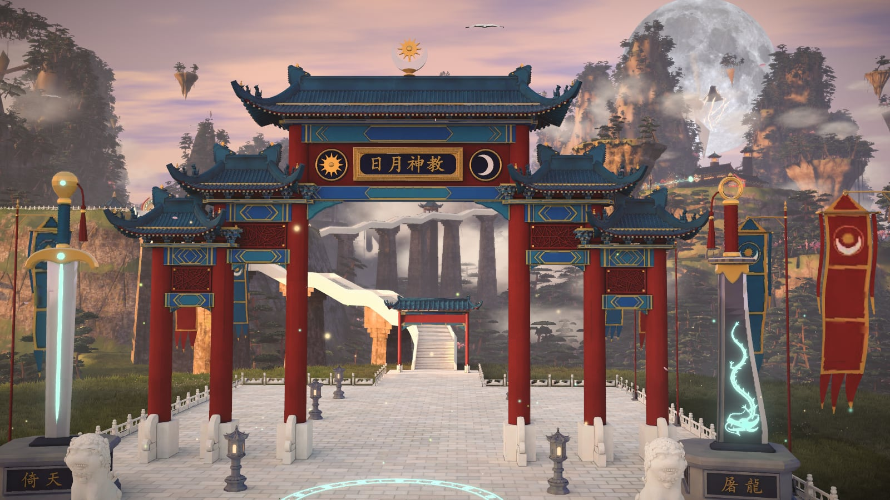
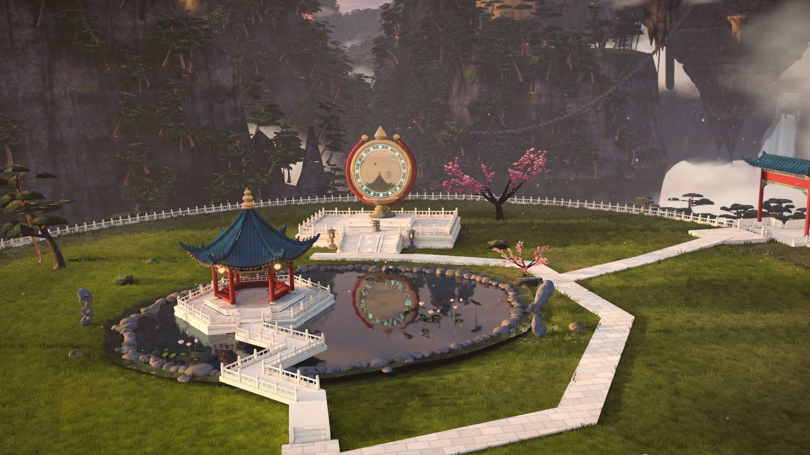
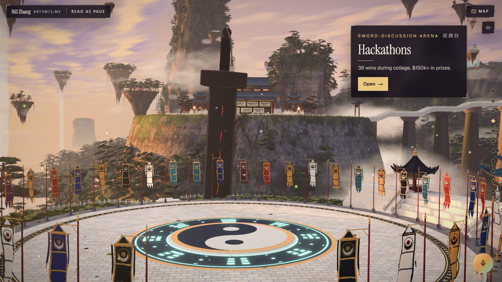
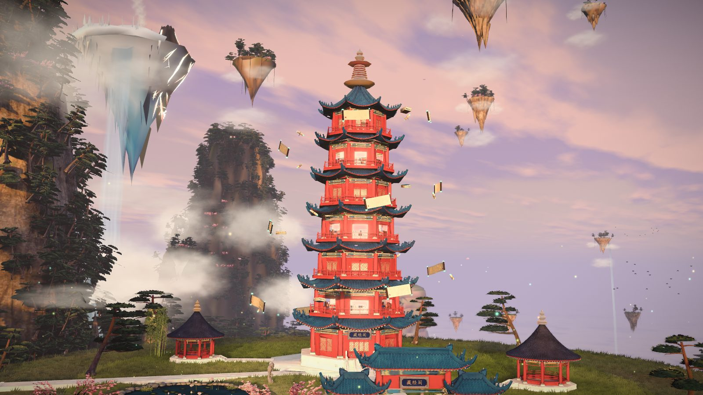
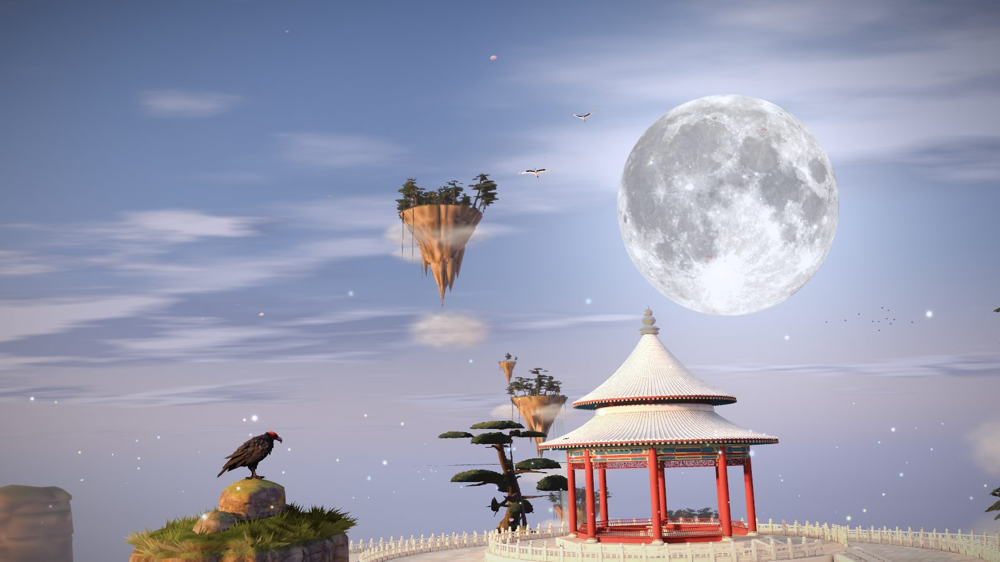
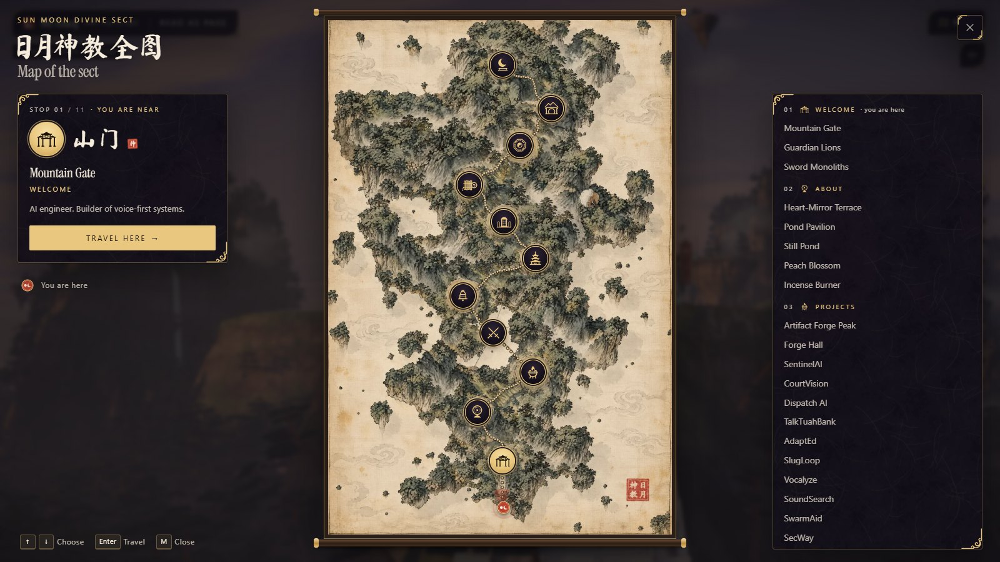
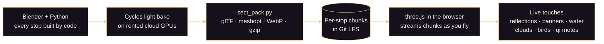
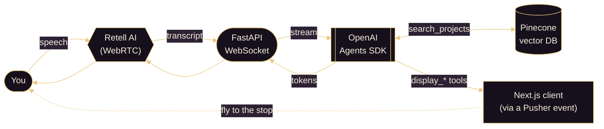

<!--
  art3m1s.me · 日月神教 Sun Moon Divine Cult
  A voice-driven AI portfolio, and a fly-through of a floating xianxia sect.
  Author: Bill Zhang (@IdkwhatImD0ing)
-->

<a id="top"></a>

<p align="center">
  
</p>

<p align="center">
  <a href="https://art3m1s.me">
    
  </a>
</p>

<p align="center">
  <a href="https://art3m1s.me"></a>
  <a href="#入门--quickstart"></a>
  <a href="https://github.com/IdkwhatImD0ing/PortfolioV5/actions/workflows/test.yml"></a>
  <a href="https://github.com/IdkwhatImD0ing/PortfolioV5/stargazers"></a>
  
</p>

<p align="center">
  
  <br/>
  <sub>山门 The Mountain Gate, the first stop. A live frame from the browser, not an offline render.</sub>
</p>

---

## 山门 · What this is

This repo is my portfolio, [art3m1s.me](https://art3m1s.me). There are two ways in.

**1. Fly through it.** The home page is a flight through a floating mountain sect. Scroll, and the camera climbs from the gate to the summit. Each of the 11 stops is one section of the portfolio. You can drag to look around, open the map, and fast-travel. **Read as page** shows everything as one plain page, without the 3D.

**2. Talk to it.** A voice agent lives in a jade talisman in the corner. Press it and ask a question. The agent searches my projects, answers out loud, and flies you to the stop it's talking about.

The sect is 日月神教, **the Sun Moon Divine Cult**, from Jin Yong's novel *The Smiling, Proud Wanderer*. I'm a big Jin Yong fan. The name also fits the site: 日月 is sun and moon, 神 is divine, and art3m1s is Artemis, goddess of the moon and the hunt. So the moon leads, and sun-and-moon marks run through the whole sect. Some treasures along the way belong to another of his sects, the Ming Sect (明教) of *Heaven Sword and Dragon Saber*.

> **Status:** the sect is now the home page of this repo's site, and the old one-page portfolio is retired. The old `/sect` address redirects to the home page. `art3m1s.me` itself still points at the previous site until the domain moves over. Until then, [run it locally](#入门--quickstart).

---

## 十一处 · The eleven stops

The camera flies one path up a floating mountain range. It stops at each place below, in this order.

| # | 中文 | Stop | Portfolio section | What you'll find |
|:-:|:-:|---|---|---|
| 1 | 山门 | Mountain Gate | Welcome | A five-bay gate with the 日月神教 plaque, guarded by the Heaven Sword and the Dragon Saber |
| 2 | 心镜台 | Heart-Mirror Terrace | About | A giant bronze mirror above a still pond. On Medium and High quality, both show live reflections |
| 3 | 炼器峰 | Artifact Forge Peak | Projects | A cauldron circled by 11 prize-winning projects, each forged into a magic artifact |
| 4 | 论剑台 | Sword-Discussion Arena | Hackathons | A floating duelling ring lined with banners, with a black iron sword driven through it |
| 5 | 任务殿 | Mission Hall | Experience | A wall of seven white-jade boards, one for each role |
| 6 | 藏经阁 | Scripture Pavilion | Education | A seven-storey pagoda with one glowing floor per school and scrolls circling it |
| 7 | 碑林 | Stele Forest | Skills | Rows of glowing stone tablets, one colour per skill area |
| 8 | 玉简阁 | Jade Slip Pavilion | Resume | The resume, kept the way a sect keeps its records |
| 9 | 护宗大阵 | Grand Sect-Protecting Formation | How this site works | Eight carved pillars with holy-fire braziers around a bronze armillary sphere. Each pillar explains one part of how the site works |
| 10 | 洞府 | Cave Abode | Off the clock | A cliff home with a waterfall, a koi pool and a tea pavilion |
| 11 | 望月台 | Moon-Gazing Terrace | Contact | The summit under a giant moon. Click the moon to talk to the AI |

---

## 画卷 · Gallery

<table>
  <tr>
    <td width="50%"></td>
    <td width="50%"></td>
  </tr>
  <tr>
    <td><sub>心镜台 Heart-Mirror Terrace. The still pond reflects the bronze mirror.</sub></td>
    <td><sub>论剑台 Sword-Discussion Arena, with its panel open. "Open" shows all 36 wins.</sub></td>
  </tr>
  <tr>
    <td width="50%"></td>
    <td width="50%"></td>
  </tr>
  <tr>
    <td><sub>藏经阁 Scripture Pavilion. Scrolls circle the pagoda. The ice island at top left is Ice-Fire Island.</sub></td>
    <td><sub>望月台 Moon-Gazing Terrace, the end of the flight. The Divine Condor waits on its rock.</sub></td>
  </tr>
</table>

<p align="center">
  
  <br/>
  <sub>日月神教全图, the map of the sect (press <kbd>M</kbd>). Pick a seal and the camera fast-travels there.</sub>
</p>

---

## 炼器 · How it's built

炼器 means "forging artifacts". Here is how the sect gets from code to your browser.



1. **Built by code.** The whole sect is Python scripts that run inside Blender: one module per stop, plus shared libraries for buildings, props, trees, rock and water. The build code is about 55,000 lines. A few CC0 photo textures and one CC BY model come from outside (see [Credits](#鸣谢--credits)).
2. **Lit once, offline.** The lighting is baked in Cycles, Blender's path tracer, on a rented RTX 5090 in the cloud. A quick development bake takes about an hour and a half. The browser never computes this lighting. It just reads the result.
3. **Packed small.** [`sect_pack.py`](./blender/xianxia-sect/tools/sect_pack.py) packs each stop into its own glTF files (meshopt geometry, WebP textures, gzip), then checks every file before installing it. There are 55 files, about 190 MB in all: a full set, plus a lighter set for phones. A visitor downloads only one set, a few stops at a time.
4. **Drawn live.** The page uses three.js through React Three Fiber. It shows the baked light and adds live layers on top: real reflections in the Heart-Mirror and its pond (Medium and High quality), banners that wave, flowing water, drifting clouds, birds, cranes, glowing qi motes and peach petals.
5. **Fits the device.** It picks a Low, Medium or High quality tier from your device, and you can change it. If frames run slow, it steps the quality down until they don't.

Other things to try in the sect:

- **Drag** to look around at any stop (or hold the left and right arrow keys).
- **Hover** a Jin Yong item to see a small card about it.
- **Press <kbd>M</kbd>** for the ink-wash world map. Click a seal to fast-travel there, Black Myth: Wukong style.
- **Turn on the music.** Each stop has its own instrumental track. It starts muted.
- **Read as page** shows the same content as a plain page, without the 3D.

The full scene contract is in [`blender/xianxia-sect/spec.md`](./blender/xianxia-sect/spec.md).

---

## 传音 · The voice agent

传音 means "sound transmission", the way cultivators talk across a distance. The voice agent is the original heart of this portfolio. In the sect it speaks as the sect's guide, through a 传音符 (a sound-transmission talisman).



- **Voice as the router.** The agent calls tools like `display_project` and `display_hackathons_page`. The server turns each call into a small navigation message, sends it through Retell's metadata channel, and the browser flies to the stop that holds that section.
- **Search by meaning.** Every project is embedded into Pinecone with `text-embedding-3-large`. Ask "what did you build for emergency dispatch?" and it finds **DispatchAI**, even though you never said its name.
- **Guardrails that don't slow you down.** A small classifier checks each question while the main model starts answering. If it flags the question, the answer is cancelled and replaced with a polite refusal. Normal questions get their first word with no extra wait.
- **Streaming end to end.** Words stream from OpenAI through FastAPI to Retell, so the agent starts speaking before its answer is finished.
- **Findable by people and by AI.** The server renders the whole portfolio as text under the flight, so search engines, language models and browsers without JavaScript can read it. JSON-LD and [`/llms.txt`](https://art3m1s.me/llms.txt) describe the site too.

---

## 彩蛋 · Jin Yong easter eggs

These 19 objects from Jin Yong's novels are hidden along the flight. Hover one (or tap it on a phone) to see what it is.

| Stop | Items | From |
|---|---|---|
| Mountain Gate | 倚天劍 Heaven-Reliant Sword · 屠龍刀 Dragon-Slaying Saber · 日月 Sun and Moon | *Heaven Sword and Dragon Saber* · the sect's name, from *The Smiling, Proud Wanderer* |
| Heart-Mirror Terrace | 玉簫 Huang Yaoshi's Jade Flute · 思過崖 Cliff of Reflection | *Legend of the Condor Heroes* · *The Smiling, Proud Wanderer* |
| Artifact Forge Peak | 金銀銅鐵鉛五輪 Five Metal Wheels | *Return of the Condor Heroes* |
| Sword-Discussion Arena | 玄鐵重劍 Black Iron Heavy Sword · 華山論劍 the seats of the Five Greats | *Return of the Condor Heroes* · *Legend of the Condor Heroes* |
| Mission Hall | 天罡北斗陣 Big Dipper Formation | *Legend of the Condor Heroes* |
| Scripture Pavilion | 冰火島 Ice-Fire Island | *Heaven Sword and Dragon Saber* |
| Stele Forest | 聖火令 the Ming Sect's Holy Flame Tablets · 獨孤九劍 Nine Swords of Dugu | *Heaven Sword and Dragon Saber* · *The Smiling, Proud Wanderer* |
| Jade Slip Pavilion | 劍塚 Sword Tomb | *Return of the Condor Heroes* |
| Grand Formation | 五行旗 the Ming Sect's Five Element Banners · 聖火 the Ming Sect's Holy Flame | *Heaven Sword and Dragon Saber* |
| Cave Abode | 笑傲江湖 Qu Yang and Liu Zhengfeng's duet | *The Smiling, Proud Wanderer* |
| Moon-Gazing Terrace | 神鵰 Divine Condor · 金鈴索 Golden Bell Rope · 綠竹巷 Green Bamboo Lane | *Return of the Condor Heroes* · *The Smiling, Proud Wanderer* |

The stele rows carry martial-arts manuals from the novels too, and each role tablet in the Mission Hall takes one star of the Big Dipper.

---

## 法器 · Tech stack

<p align="center">
  <a href="https://skillicons.dev">
    
  </a>
</p>

<details>
<summary><b>Full breakdown</b> · click to expand</summary>

| Layer | Tech | Why |
|---|---|---|
| **Frontend** | Next.js 15 (App Router) · React 19 · TypeScript 5 · Tailwind v4 · Retell web SDK | Fast, modern, voice-ready |
| **3D** | three.js · React Three Fiber · drei · postprocessing · three-mesh-bvh | The sect fly-through, picking and post effects |
| **Scene build** | Blender 5.2 Python · Cycles on cloud RTX 5090s · glTF Transform + meshopt · WebP · Git LFS | Procedural sect, baked light, small streamed files |
| **Backend** | FastAPI · Uvicorn · OpenAI Agents SDK · Retell SDK · Pydantic | Streaming WebSocket and a tool-calling agent |
| **Vector DB** | Pinecone · `text-embedding-3-large` | Semantic search across projects |
| **Infra** | Docker · Cloud Run · Vercel · ngrok (dev) | One-command deploys |
| **Observability** | Vercel Analytics · Speed Insights · structured logs · [FireTrace](https://tracing.art3m1s.me) | Real-user performance, plus one trace per agent run |
| **Tests** | Vitest · pytest · GitHub Actions | 1,556 client and 365 server tests. CI runs them on every push to main, minus 10 that need real API keys |

</details>

---

## 入门 · Quickstart

入门 means "entering the gate", which is also how Chinese says "getting started".

The fly-through only needs the client:

```bash
git lfs install          # the sect's scene files live in Git LFS
git clone https://github.com/IdkwhatImD0ing/PortfolioV5.git
cd PortfolioV5/client
pnpm install
pnpm dev                 # then open http://localhost:3000
```

Add `?tier=low`, `?tier=mid` or `?tier=high` to force a quality tier, or `?view=page` to read the sect as a plain page. If you cloned before installing Git LFS, run `git lfs pull` to fetch the scene files.

<details>
<summary><b>Running the voice agent too</b></summary>

The voice agent needs the server, a public address for Retell to reach it, and the keys below.

```bash
make install-deps                                # uv, pnpm and ngrok, then each app's packages
cd server && uv run uvicorn main:app --reload    # :8000
cd client && pnpm dev                            # :3000
ngrok http 8000                                  # a public URL for Retell to reach the server
```

Then open **http://localhost:3000** for the voice portfolio.

</details>

### Environment variables

Names only. Never commit the values.

```bash
# server/.env
RETELL_API_KEY=...
OPENAI_API_KEY=...
PINECONE_API_KEY=...
FIRETRACE_API_KEY=...            # optional: records every agent run
PUSHER_SECRET=...                # voice page moves + live captions (server/README.md, "Voice events")

# client/.env.local (see client/.env.local.example)
RETELLAI_API_KEY=...             # server-side only, used by the create-web-call proxy
NEXT_PUBLIC_RETELL_AGENT_ID=...
NEXT_PUBLIC_APP_URL=http://localhost:3000
NEXT_PUBLIC_API_URL=...          # optional: backend URL for warm-up and text chat
```

### Tests

```bash
cd client && pnpm lint && pnpm typecheck && pnpm test
cd server && uv run pytest tests/ -m "not integration"   # what CI runs
```

---

## 藏经阁 · Modules and docs

藏经阁 is the Scripture Pavilion, where a sect keeps its manuals.

| Module | What lives there |
|---|---|
| [`client/`](./client) | Next.js 15 UI · the sect fly-through (the home page) · voice orb · `/api/create-web-call` and `/api/chat` proxies |
| [`server/`](./server) | FastAPI WebSocket · OpenAI Agents · navigation and search tools · guardrails |
| [`pinecone/`](./pinecone) | One-shot ingestion: `data.json` → embeddings → Pinecone index |
| [`browserless/`](./browserless) | Deploy script for a separate headless-browser service (Browserless) on Cloud Run |
| [`blender/xianxia-sect/`](./blender/xianxia-sect) | The Sun Moon Divine Cult: Blender Python for every stop, the light bake, and the packer for the web files |
| [`music/sect-themes/`](./music/sect-themes) | The prompts behind each stop's music |
| [`research/`](./research) | Background research: fact checks, voice platform comparison, design audits |

Deeper docs: [`client/docs`](./client/docs) · [`server/docs`](./server/docs) · [`pinecone/docs`](./pinecone/docs) · [`blender/xianxia-sect/docs`](./blender/xianxia-sect/docs) (including [the Jin Yong references](./blender/xianxia-sect/docs/jin-yong-references.md))

---

## 法宝 · Featured projects

Four of the projects the agent knows about. All four won prizes, and each one is an artifact on the forge's ring.

<p align="center">
  <a href="https://github.com/IdkwhatImD0ing/DispatchAI">
    
  </a>
  <a href="https://github.com/aurelisajuan/TalkTuahBank">
    
  </a>
  <a href="https://github.com/IdkwhatImD0ing/SlugLoop">
    
  </a>
  <a href="https://github.com/IdkwhatImD0ing/AdaptEd">
    
  </a>
</p>

<p align="center">
  <a href="https://github.com/IdkwhatImD0ing">
    
  </a>
</p>

---

## 鸣谢 · Credits

- **Divine Condor** model: "Dark Vulture" by [Pigcraft](https://sketchfab.com/s8819296) on Sketchfab, [CC BY 4.0](https://creativecommons.org/licenses/by/4.0/), reduced and re-textured.
- **Photo textures** from [Poly Haven](https://polyhaven.com) and [ambientCG](https://ambientcg.com). Pine twig texture: "Pine Tree 01" by Rob Tuytel and Rico Cilliers. Mist flipbooks by Thomas Iché (Unity Labs), via the Brackeys VFX Bundle. Waterfall texture by Martin Vorel (LibreShot). All CC0.
- The full list is in [`blender/xianxia-sect/assets/CREDITS.md`](./blender/xianxia-sect/assets/CREDITS.md).
- The sect, its treasures and its martial arts come from the novels of **Jin Yong** (金庸).

---

## 传书 · Connect

<p align="center">
  <a href="https://art3m1s.me"></a>
  <a href="https://www.linkedin.com/in/bill-zhang1/"></a>
  <a href="https://github.com/IdkwhatImD0ing"></a>
  <a href="https://devpost.com/IdkwhatImD0ing"></a>
  <a href="mailto:billzhangsc@gmail.com"></a>
</p>

---

## 星图 · Star history

<p align="center">
  <a href="https://star-history.com/#IdkwhatImD0ing/PortfolioV5&Date">
    
  </a>
</p>

<p align="center">
  <sub>If this project sparks an idea, a ⭐ helps a lot.</sub>
</p>

<p align="center">
  <a href="#top">⬆ Back to the gate</a>
</p>

<p align="center">
  
</p>
